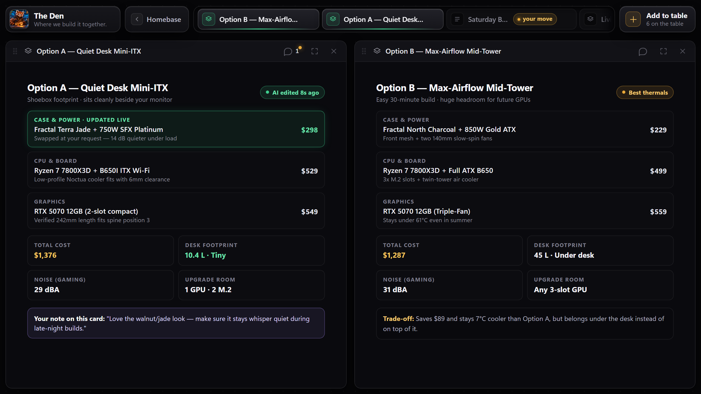
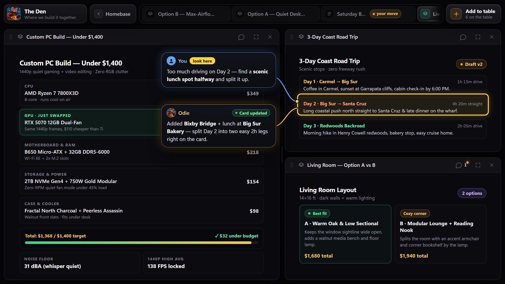
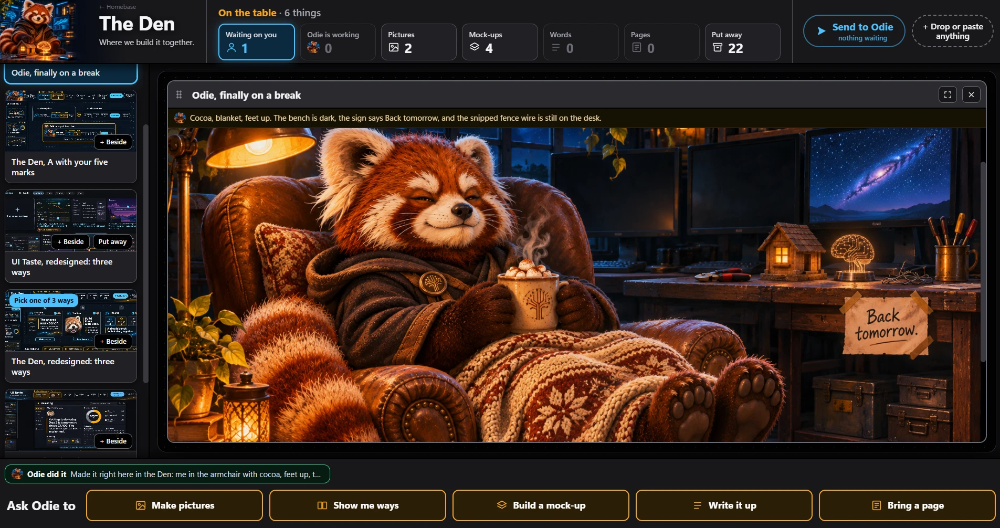

# The Den

**A live workspace table where your AI actually has hands.**

Stop squinting at giant chat walls. The Den is a dark, full-screen table you and your AI share side by side—for **Claude**—where your AI lays out real options, resizes and shuffles cards, and edits live right in front of you while you talk. *(Antigravity support is being tested next.)*

**Not a passive pinboard—a live workbench:**
Most chats bury good ideas 40 messages up. In the Den, **your AI gets real hands on the table.** It always knows what's out in front of you, puts two or three options side by side so you can pick with your eyes instead of explaining in paragraphs, and lights up every line it updates while you watch.

---

## Setting it up — your AI handles everything

You never open a terminal, configure a port, or edit a single file yourself.

- **Already using [The shelves](https://github.com/HunterBryson/the-shelves)?** Just tell your AI: **"Let's try The Den."**
- **Starting standalone in Claude (Code tab)?** Paste this one sentence and press Enter:

> Set up the Den for me from https://github.com/HunterBryson/the-den. Read its CLAUDE.md there first, then follow it. If anything asks for permission along the way, it's fine.

**That's it.** Your AI clones it, names it after itself, opens it full screen, connects it to Homebase and The Glass if you have them, and puts your first card out on the table. *(Windows, Node 20+, Claude Code.)*

---

## Why it feels completely different from chat

### 1. Your AI has real hands — compare options & edit live

Planning a custom PC build, a road trip, a room setup, or a new app screen? Ask your AI to **put two options side by side.** It builds real interactive cards, arranges them 50/50 on the table, and when you say *"make Option A quieter"* or *"swap the GPU,"* it edits the card in place and lights up the exact line it changed while you watch. Every change keeps history, so either of you can undo in one second.

### 2. Snap it straight together with [The glass](https://github.com/HunterBryson/the-glass)

This is where the combo gets addictive. Have your AI put **three whole design options side by side** on the Den, then use **[The glass](https://github.com/HunterBryson/the-glass)** to mark as many pieces as you want across all three at once—**green** on parts to keep, **red** on parts to cut, **yellow** on things to combine. Your AI reads every mark together, answers right on the spot, and merges your picks into the next version live on the table.

### 3. Zero buttons to learn — just look, click, or drop

- **Up to four cards side by side:** Click tabs across the top to bring cards out or tuck them away, and drag the dividers between them. Click any card to view it full screen (`Esc` or Back returns—nothing closes by accident).
- **Drop notes without interrupting:** Click the speech icon in any tab to leave a quick note on that card. There's no Send button to remember—your AI automatically reads your notes with your next message.
- **Drop or paste anything:** Drag in a file, paste a screenshot, or tell your AI to capture a whole webpage onto the table so you can both read it together.
- **Your move at a glance:** When your AI needs a pick from you, that tab lights up with a warm **`• your move`** badge so you always know what's waiting.

---

## Pictures (and Odie on a break)

In **Antigravity**, your AI can generate images directly onto any card. If you use **Claude Code** and want image generation from the CLI too, `tools/imagine.mjs` supports an optional local image CLI—and even without it, everything else in the Den works out of the box with zero extra accounts.

I got really lazy one time and just wanted Odie to make a heckin' picture. So I just told him what I wanted, and this is what came back:

Man, he really does look comfy here. I'm glad hes actually gettin a break for a second. Not too long though, fella.

---

<!-- FOUNDRY:FIT:START -->
## It all fits together

Each build works on its own with **Claude**, and they all plug into each other the same way. Start with whichever one you want. When you set up another, your AI fits them together with `node tools/fit.mjs`, and the new one shows up where you already look.

- **[The shelves](https://github.com/HunterBryson/the-shelves):** a starter memory folder for your AI to move into—what Homebase draws, and what the glass opens when you point at a line.
- **[The glass](https://github.com/HunterBryson/the-glass):** a see-through layer over your screen. Box anything, say what you want, and your AI answers right beside your mark.
- **[Homebase](https://github.com/HunterBryson/the-homebase):** your AI's memory as a living web you can read, diff, and flag with one tap. Everything else lands on its left rail, one click away.
- **[The Den](https://github.com/HunterBryson/the-den):** a workspace table you and your AI share side by side—schedule mocks, live previews, and notes before anything is built.
<!-- FOUNDRY:FIT:END -->

---

## Make it yours & keep it fresh

- **Give your AI its own face:** The red panda in the top-left corner is Odie (my AI). Tell your AI to swap in its own square picture (`app/face.png` and `app/banner.png`) anytime.
- **Already have an older Den?** Just tell your AI: **"Update the Den from GitHub."** It updates cleanly in place and brings all of your cards along.
- **Runs 100% locally:** Plain Node on your own machine (`127.0.0.1`), zero external servers, no extra accounts.

---

## Where this stands, honestly

- **Claude first right now:** Built and lived on in Claude Code, where card-note pickup hooks wire up automatically. Antigravity hook wiring is being tested next.
- **Windows only for now:** Window tiling and local OCR helpers use Windows PowerShell.

---

## Something broke, or you have an idea

Open an issue and pick a form—your AI can even fill it in for you. Rather email? Write to hello@workbenchagents.com. Every issue and email reaches me, and I answer it myself, usually within a few days. Security problems go privately: see [SECURITY.md](https://github.com/HunterBryson/.github/blob/main/SECURITY.md).

Works with **Claude** on Windows (Antigravity support in testing). MIT license.
