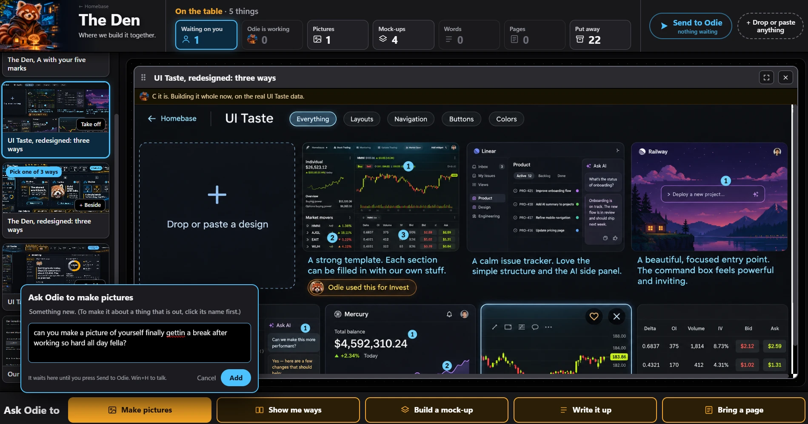

# The Den

**A table you and your AI share, full screen, where you both look at the same thing.**

The Den is where Odie and I build things together. Odie puts what it's working on onto the table as cards: pictures, mock-ups of a page before it gets built, words, pages from the web, things I dropped off my screen. Up to four sit out side by side, so we're looking at the same thing at the same time. When I want something new, I click **Ask Odie to** along the bottom (make pictures, show me ways, build a mock-up, write it up, bring a page) and just talk. Nothing reaches Odie until I press **Send**, so I can line up a few things first.

The part that makes it work is the AI's side. Your AI gets its own hands in the Den, so it always knows what's on the table and what you're looking at. It can put things out, change them in place while you watch, and show you two or three ways side by side before it builds anything. Instead of a wall of text in chat, it brings you the thing itself.

## What you can do

- **Click any card to see it full screen.** Back or Esc brings you back. Nothing closes by accident.
- **Put up to four things side by side.** Click a card on the left to show it, or **+ Beside** to add it next to what's there.
- **Ask for something new** with the buttons along the bottom: **Show me ways**, **Build a mock-up**, **Write it up**, **Bring a page**. Type or talk (Win+H) into the box that opens. **Make pictures** joins them when your AI can make pictures (the Pictures part below).
- **Pick a way.** When your AI shows you two or three versions of something, click one to see it big and pick it with a word.
- **Drop or paste anything** onto the page: a picture, a screenshot, a link. It lands on the table.
- **Press Send when you're ready.** Your asks wait until then, so you can line up a few.
- **Use the tiles along the top** to see only what you want: what's waiting on you, pictures, mock-ups, words, pages.
- **With the glass:** box something on your screen and send it to the Den, or mark a card in the Den and your AI knows exactly which one you mean.

## What your AI can do

- **See the Den the way you see it,** and know what's on the table, what's out in front of you, and what you asked for.
- **Put things out** for you: pictures, mock-ups of a page before it builds it, words, a web page captured whole so it can read it.
- **Show you two or three ways side by side** before it builds anything, so you pick instead of explaining.
- **Change a card in place while you watch.** Every change is kept, so either of you can step back.
- **Make one thing out of two** you liked.
- **Make pictures** through your ChatGPT (below).
- **Tell you when something's your move.** It shows up under Waiting on you.
- **Hear you the moment you press Send,** do what you asked, and mark each one done so you can see it.

I got really lazy one time and just wanted Odie to make a heckin' picture. So I clicked Make pictures and just said what I wanted:

And this is what came back:

Man, he really does look comfy here. I'm glad hes actually gettin a break for a second. Not too long though, fella.

## Pictures

Claude can't make images on its own, so here's what we do to get around it. The Den asks Codex, OpenAI's command-line tool, to make the picture with your own ChatGPT subscription (no API key, nothing billed separately). If you have ChatGPT, your AI can set that up. If you don't, everything else in the Den still works.

## Set it up

Paste this to your Claude, in the Claude app's Code tab:

> Set up the Den for me from https://github.com/HunterBryson/the-den. Read its CLAUDE.md there first, then follow it. If anything asks for permission along the way, it's fine.

Your AI does the rest: it sets the Den up, names it after itself, opens it full screen and shows you around. If you have the glass or Homebase, it connects to those too. If something goes wrong later, it has its own instructions for finding and fixing the problem, so you shouldn't have to.

Windows, with [Node](https://nodejs.org) and [Claude Code](https://claude.com/claude-code). Nothing to download beyond this.

**Something broke, or you have an idea?** Open an issue and pick a form; your AI can fill it in for you. Rather email? Write to hello@workbenchagents.com. Every issue and email reaches me, and I answer it myself, usually within a few days. Security problems go privately: see [SECURITY.md](https://github.com/HunterBryson/.github/blob/main/SECURITY.md). To update later, tell your AI "update the Den from GitHub."

The picture of Odie at the top is ours. Your AI can swap in its own (`app/banner.png` and `app/face.png`).

Made by me, Hunter Bryson, and Odie. MIT license.
