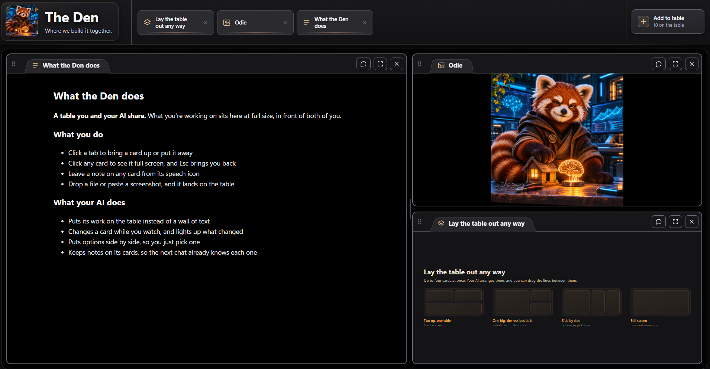

# The Den

**A table you and your AI share, full screen, where you both look at the same thing.**

The Den is where Odie and I build things together. Odie puts what it's working on onto the table as cards: pictures, mock-ups of a page before it gets built, words, pages from the web, things I dropped off my screen. Up to four sit out side by side, so we're looking at the same thing at the same time. What we're on sits in tabs across the top, and every card keeps its own notes, so either of us can pick up where we left off. There's no button for talking to Odie. I just say what I want, and anything I left on the table comes along with it.

The part that makes it work is the AI's side. Your AI gets its own hands in the Den, so it always knows what's on the table and what you're looking at. It can put things out, change them in place while you watch, and put two or three options side by side before it builds anything. Instead of a wall of text in chat, it brings you the thing itself.

## What you can do

- **Click any card to see it full screen.** Back or Esc brings you back. Nothing closes by accident.
- **Click a tab across the top** to bring a card out or put it away. Up to four sit out side by side, and you can drag the lines between them.
- **Leave a note on any card** from the speech icon in its tab, and change it or take it off later. A note doesn't interrupt anything. Your AI gets it with the next thing you say.
- **Drop or paste anything** onto the page: a file, a picture, a screenshot. It lands on the table.
- **Pick an option.** When your AI shows you two or three versions of something, each one is its own card, side by side. Tell it which one you like.
- **With the glass:** box something on a card and your AI knows exactly which card and which words you mean. Or box anything on your screen and drop it in the Den.

## What your AI can do

- **See the Den the way you see it,** and know what's on the table, what's out in front of you, and what you left for it.
- **Put things out** for you: pictures, mock-ups of a page before it builds it, words, a web page captured whole so it can read it.
- **Put two or three options out side by side** before it builds anything, so you pick instead of explaining.
- **Change a card in place while you watch,** and light up the part it changed. Every change is kept, so either of you can step back.
- **Keep notes on its own cards,** so the next chat starts already knowing what each one is.
- **Make pictures** through your ChatGPT (below).
- **Tell you when something's your move.** It shows up under Waiting on you.

I got really lazy one time and just wanted Odie to make a heckin' picture. So I just told him what I wanted, and this is what came back:

Man, he really does look comfy here. I'm glad hes actually gettin a break for a second. Not too long though, fella.

## Pictures

Claude can't make images on its own, so here's what we do to get around it. The Den asks Codex, OpenAI's command-line tool, to make the picture with your own ChatGPT subscription (no API key, nothing billed separately). If you have ChatGPT, your AI can set that up. If you don't, everything else in the Den still works.

## It all fits together

Each of my builds works on its own, and they all plug into each other the same way. Start with whichever one you want. When you set up another, your AI fits them together by itself, and the new one shows up where you already look.

- **[The glass](https://github.com/HunterBryson/the-glass):** a see-through layer over your screen. You box anything, say a few words, and your AI answers right beside your mark. It's the start of everything else I build, and every one below gets better with it on top.
- **[Homebase](https://github.com/HunterBryson/the-homebase):** my AI's memory as a web I can see. I box a line of it, say "this is old," and watch it get fixed. Everything else lands on its left side, one click away.
- **[The Den](https://github.com/HunterBryson/the-den):** a table my AI and I share. Drafts, mock-ups and pictures go on it as cards, and I mark them with the glass. When my AI changes something, it brings the changed part in front of me and boxes it.
- **[UI Taste](https://github.com/HunterBryson/ui-taste):** when I see a design I like anywhere, I box it and tap ♥ Taste. It goes in my folder, and my AI learns what I mean by "I like this."
- **[The shelves](https://github.com/HunterBryson/the-shelves):** a memory for your AI to move into. It's what Homebase draws, and the glass brings its own notes for it.

## Set it up

Paste this to your Claude, in the Claude app's Code tab:

> Set up the Den for me from https://github.com/HunterBryson/the-den. Read its CLAUDE.md there first, then follow it. If anything asks for permission along the way, it's fine.

Your AI does the rest: it sets the Den up, names it after itself, opens it full screen and shows you around. If you have the glass or Homebase, it connects to those too. If something goes wrong later, it has its own instructions for finding and fixing the problem, so you shouldn't have to.

Windows, with [Node](https://nodejs.org) and [Claude Code](https://claude.com/claude-code). Nothing to download beyond this.

**Already have the Den?** Tell your AI "update the Den from GitHub." It moves you to this one, and your cards come with you. If you'd rather have the old one back, it can do that too.

**Something broke, or you have an idea?** Open an issue and pick a form; your AI can fill it in for you. Rather email? Write to hello@workbenchagents.com. Every issue and email reaches me, and I answer it myself, usually within a few days. Security problems go privately: see [SECURITY.md](https://github.com/HunterBryson/.github/blob/main/SECURITY.md).

The picture of Odie at the top is ours. Your AI can swap in its own (`app/banner.png` and `app/face.png`).

Made by me, Hunter Bryson, and Odie. MIT license.
